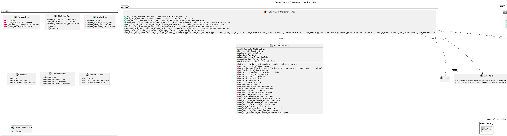

# Smart Tester


### A unit test function/classes generator for Python/Java
Smart Tester provides the generation of unit tests for the given functions, through multi-step prompts to an LLM.

This approach is inspired by "Unit test writing using a multi-step prompt" by Ted Sanders (https://github.com/ted-at-openai), from the official OpenAI Cookbook on Github (https://github.com/openai/openai-cookbook/blob/main/examples/Unit_test_writing_using_a_multi-step_prompt.ipynb).

As suggested by the CookBook, 4 base steps are provided:
1. Explain: Given a Python function, we ask GPT to explain what the function is doing and why..
2. Plan: We ask GPT to plan a set of unit tests for the function.
3. If the plan is too short, we ask GPT to elaborate with more ideas for unit tests.
4. Execute: Finally, we instruct GPT to write unit tests that cover the planned cases.

In this project 2 additional steps are structured:
5. Post-processing: Fix common errors produced by the LLM-generated unit test code
6. Verify: Verify if the post-processed code is executable

### Provided functionalities
- Develop an LLM-based service to generate test functions for Python, with pytest (and pytest.mark.parametrize)
- Saved intermediate steps in persistent files to review step outputs and restart computation from an intermediate step 

### How to use:
1. Clone/fork the project
2. Open the project using your favorite SDK (PyCharm, Visual Studio Code, ...)
3. Install the proper virtual environment with proper dependencies with uv (see below in "[Setup with uv (Recommended)](#setup-with-uv-recommended)") 
4. Set the environment variable "OPENAI_API_KEY" to link your OpenAI API Key (https://platform.openai.com/account/api-keys)  
5. Execute the main function from _smarttester\scripts\gtp35_python_smart_testing_example_runner.py_, using the desired function_to_tests and parameters, as follows in this screenshot

6. If parameter "_print_text_" is set as _True_, results are printed in the terminal:

7. If parameter "_save_text_" is set as _True_, results and intermediate steps are saved as files in __smarttester\package\smarttester\resources\data\saved_files_


#### Setup with uv (Recommended)
1. Clone/fork the project
2. Install [uv](https://docs.astral.sh/uv/getting-started/installation/) package manager (from bash):
   ```bash
   curl -LsSf https://astral.sh/uv/install.sh | sh
   ```
3. Follow the instructions below based on your OS:
3A. For Windows (MINGW64/Git Bash):
```bash
cd smart-tester

# Ensure uv is in PATH (if using MINGW64)
export PATH="/c/Users/{your-username}/.local/bin:$PATH"

# Create virtual environment and install dependencies
uv sync
```

3B. For Linux/macOS or Windows PowerShell:
```bash
cd smart-tester

# Create virtual environment and install dependencies
uv sync
```


### In-progress functionalities:
- UML: A PlantUML class diagram (uml_classes.puml) has been added at the repository root. See the "UML diagram" section below for details.

### UML diagram
A PlantUML source file named `uml_classes.puml` lives at the root of this repository. It documents the project's dataclasses, service classes, and utility modules (including public methods). The diagram was auto-generated to match the current code structure.

How to render the PlantUML diagram:

1. Quick online rendering:
   - Visit https://www.plantuml.com/plantuml/ and paste the contents of `uml_classes.puml` into the editor.

2. Local rendering with plantuml.jar:
   - Install Graphviz and Java if not already available.
   - Run: `java -jar plantuml.jar uml_classes.puml` from the repository root. This will produce `uml_classes.png`.

3. Using Docker:
   - `docker run --rm -v $(pwd):/workspace plantuml/plantuml -tpng /workspace/uml_classes.puml`

4. Visual Studio Code:
   - Install the "PlantUML" extension and open the file. Use the preview feature to render the diagram.

Notes:
- The `.puml` file is plain text and human-readable, but visual rendering helps to navigate relationships.
- A rendered PNG of the diagram is included at `uml_classes.png` for quick viewing on GitHub and locally.

Embedded diagram (rendered):



If you prefer an SVG or different format, I can also generate that and commit it.

### In-progress functionalities:
- Automated post-processing to fix usual LLM's specific errors in generating pytest tests
- Exposition of API to call pytest test generation services from a client

- Develop an LLM-based service to generate test functions for Java, with junit5 (and ParameterizedTest)
- Automated post-processing to fix usual LLM's specific errors in generating junit tests
- Exposition of API to call junit test generation services from a client

- Exposition of a Frontend to provide an interface to the exposed API
  
